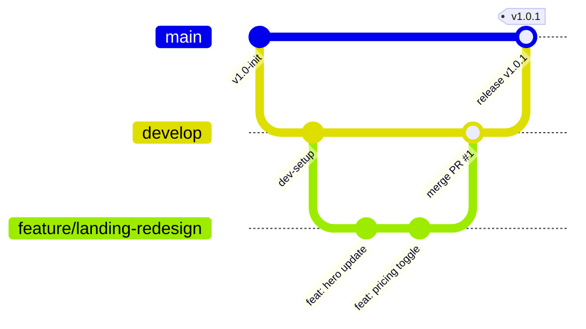

# 📦 Despacha Fácil — Frontend (Next.js 14 / TypeScript / Tailwind CSS)

> **Plataforma SaaS Multi-Tenant para Comercio Social y Retail en Perú y Latinoamérica.**  
> Elimina las sobreventas por WhatsApp/redes sociales mediante catálogos web mobile-first con reserva atómica y tableros Kanban de despacho.

---

## 👥 Equipo de Desarrollo

| Desarrollador | Usuario GitHub | Rol Principal |
| :--- | :--- | :--- |
| **Rommel Navarro** | [@Edudev2004](https://github.com/Edudev2004) | Lead Developer & Arquitectura Core |
| **Angella Pairazamán** | [@AngeDev-Ing](https://github.com/AngeDev-Ing) | Frontend Developer / Landing Page & UX UI |

---

## 🏗️ Arquitectura por Features (Feature-Driven Design)

El proyecto abandona la división clásica por tipos de archivos y se organiza por **capacidades de negocio (Features)**. Cada feature es autosuficiente y desacoplada:

```text
src/
├── app/                              # Next.js App Router (Rutas y Páginas)
│   ├── layout.tsx                    # Layout raíz global
│   ├── page.tsx                      # Renderiza la Landing Page
│   ├── tienda/[slug]/                # Catálogo público del comercio (despachafacil.com/tienda/[slug])
│   ├── login/                        # Inicio de sesión para dueños de tienda
│   ├── registro/                     # Registro de nuevo tenant (Onboarding)
│   └── app/                          # Panel administrativo del comercio (app.despachafacil.com)
│       └── dashboard/                # KPIs, métricas y accesos directos
│
├── features/                         # MÓDULOS DE NEGOCIO DESACOPLADOS
│   ├── landing/                      # 🌟 APARTADO DE LA LANDING PAGE (Asignado a Angella)
│   │   ├── components/               # Navbar, HeroSection, FeaturesSection, PricingSection, etc.
│   │   ├── data/                     # Textos, planes y FAQs editables (landingContent.ts)
│   │   ├── types/                    # Interfaces de la landing (landing.types.ts)
│   │   └── index.ts                  # Exporta <LandingPage />
│   │
│   ├── catalog-public/               # Catálogo público móvil para compradores de WhatsApp
│   │   ├── components/               # ProductCard, VariantSelector, CartDrawer, WhatsAppCheckoutModal
│   │   ├── hooks/                    # useCart, usePublicCatalog
│   │   ├── services/                 # catalogApi.ts (consumo de endpoints públicos)
│   │   └── types/                    # PublicCatalogProduct, CartItem
│   │
│   ├── products/                     # Gestión de productos, SKUs, variantes y stock
│   │   ├── components/               # ProductList, ProductForm, VariantManager
│   │   ├── services/                 # productApi.ts
│   │   └── types/                    # Product, ProductVariant
│   │
│   ├── orders/                       # Pedidos y detalle de transacciones
│   │   ├── components/               # OrderTable, OrderDetailModal
│   │   ├── services/                 # orderApi.ts
│   │   └── types/                    # Order, OrderStatus
│   │
│   ├── dispatches/                   # Tablero Kanban de Logística y Couriers (Olva/Shalom)
│   │   ├── components/               # KanbanBoard, KanbanColumn, DispatchCard
│   │   ├── services/                 # dispatchApi.ts
│   │   └── types/                    # Dispatch, DispatchStatus
│   │
│   └── auth/                         # Autenticación JWT y Tenant Context
│       ├── components/               # LoginForm, RegisterTenantWizard
│       ├── services/                 # authApi.ts
│       └── types/                    # UserSession, LoginCredentials
│
└── shared/                           # RECURSOS GLOBALES COMPARTIDOS
    ├── components/ui/                # Primitivos UI (Button, Badge, Card, Modal, Input)
    ├── lib/                          # apiClient, formatters (S/ PEN, fechas), utils (cn)
    └── types/                        # ApiResponse, PaginatedResponse, ApiError
```

---

## 🎨 Sistema de Diseño Neo-Brutalista (Design System Mandate)

Todo el ecosistema visual de Despacha Fácil sigue un estándar estricto de **Neo-Brutalismo / Editorial Brutalism** para garantizar alta conversión, identidad única y ergonomía móvil:

* **Directrices y Componentes:** Documentado exhaustivamente en [.agents/skills/despacha-facil-design-system/SKILL.md](.agents/skills/despacha-facil-design-system/SKILL.md) y [AGENTS.md](AGENTS.md).
* **Colores Semánticos:** Crema `#FAF8F5` (`bg-paper`), Tinta `#09090B` (`text-ink`, `border-ink`), Naranja Eléctrico `#FFA800` (`bg-brand-orange`), Coral `#F56917` (`bg-brand-coral`) y Menta `#34C9A8` (`bg-teal`).
* **Tipografías Oficiales:**
  * Titulares: `Dela Gothic One` (`font-display uppercase tracking-tight`).
  * Interfaz y Controles: `Space Grotesk` (`font-body font-bold` o `font-medium`).
  * Códigos y SKUs: `Geist Mono` (`font-mono text-xs`).
* **Sombras Duras:** Prohibidas sombras difusas (`shadow-md`). Se usan sombras sólidas negras `shadow-hard-sm` (2px), `shadow-hard` (4px) y `shadow-hard-lg` (8px), con traslación táctil física en clic (`active:translate-x-[2px] active:translate-y-[2px] active:shadow-none`).
* **Reglas Móviles (Android / Honor 200 Smart):**
  * Títulos y CTAs alineados a la izquierda (`text-left items-start`).
  * Espaciado vertical seguro (`pt-10 sm:pt-12`) bajo barras de navegación fijas.
  * Códigos y corchetes numéricos protegidos con `shrink-0 whitespace-nowrap` (`[01]`).
  * Apilamiento responsivo de tarjetas (`relative -mt-6 sm:absolute`).

---

## 🌿 Flujo de Trabajo GitFlow

Trabajamos con la metodología **GitFlow** estricta para garantizar orden, estabilidad y revisiones de código eficientes:



### 1. Ramas Principales
* **`main`**: Código de **producción** estable, testeado y desplegado en Vercel (`despachafacil.com` / `app.despachafacil.com`). **Prohibido hacer commits directos a `main`.**
* **`develop`**: Rama principal de **desarrollo e integración**. Todas las características nuevas se integran aquí mediante Pull Requests (PRs).

### 2. Ramas de Trabajo
* **`feature/<nombre-descriptivo>`**: Ramas creadas desde `develop` para nuevas funciones.
  * Ejemplo: `feature/landing-redesign`, `feature/cart-drawer`, `feature/kanban-dispatch`.
* **`bugfix/<nombre-descriptivo>`**: Corrección de errores detectados en `develop`.
* **`hotfix/<nombre-descriptivo>`**: Correcciones críticas urgentes nacidas directamente de `main`.

### 3. Convención de Commits (Conventional Commits)
Cada commit debe iniciar con un prefijo semántico en minúsculas:
* `feat:` Nueva funcionalidad para el usuario.
* `fix:` Corrección de un bug.
* `docs:` Cambios exclusivamente en documentación o READMEs.
* `style:` Ajustes visuales de Tailwind o espaciados que no alteran la lógica.
* `refactor:` Mejora o reestructuración de código sin agregar funciones ni romper tests.
* `chore:` Actualización de dependencias, configuración de build o linters.

### 4. Ciclo de un Pull Request (PR)
1. Actualiza tu rama local con `develop`: `git pull origin develop`.
2. Crea tu rama: `git checkout -b feature/mi-tarea`.
3. Desarrolla y commitea con commits semánticos.
4. Sube tu rama: `git push -u origin feature/mi-tarea`.
5. Abre el **Pull Request hacia `develop`** en GitHub solicitando review de tu compañero.

---

## 🚀 Puesta en Marcha Local

### Prerrequisitos
* Node.js v20+ o v22+
* npm, pnpm o bun

### Instalación y Ejecución

```bash
# 1. Clonar el repositorio
git clone https://github.com/Edudev2004/despacha-facil-frontend.git
cd despacha-facil-frontend

# 2. Instalar dependencias
npm install

# 3. Configurar variables de entorno locales
cp .env.example .env.local

# 4. Iniciar servidor de desarrollo
npm run dev
```

La aplicación estará disponible en [http://localhost:3000](http://localhost:3000).

---

## 🎨 Guía Rápida para Angella (@AngeDev-Ing) — Landing Page

La plantilla base ya está montada y funcionando en:
👉 `src/features/landing/`

* **Para editar textos, planes o preguntas frecuentes:**  
  Edita el archivo [`src/features/landing/data/landingContent.ts`](src/features/landing/data/landingContent.ts).
* **Para personalizar el diseño visual de cada sección:**  
  Encuentras los componentes en [`src/features/landing/components/`](src/features/landing/components/) (`HeroSection.tsx`, `FeaturesSection.tsx`, `PricingSection.tsx`, etc.).
* **Para probar el build antes de hacer push:**  
  Ejecuta `npm run build` para asegurar que no haya errores de TypeScript ni de compilación.
