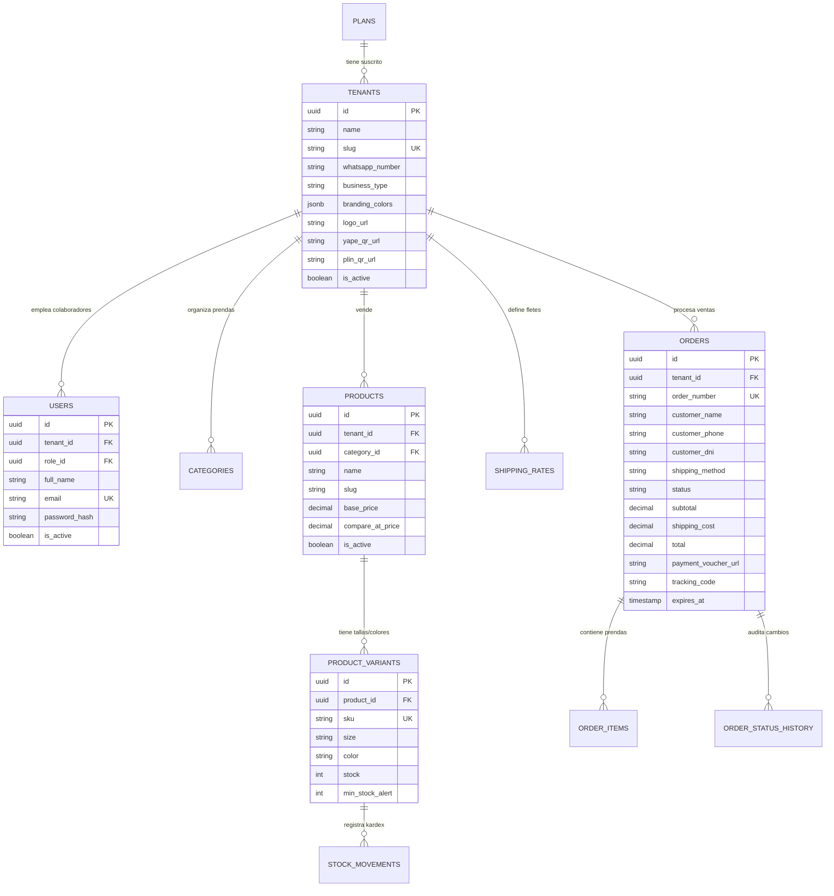

# Despacha Fácil — Arquitectura de Base de Datos & Multi-Tenancy

Este documento detalla el esquema relacional de PostgreSQL, el modelo de aislamiento multi-tenant y los estados de datos en el backend de **Despacha Fácil**.

---

## 1. Estrategia Multi-Tenant: Base de Datos Compartida, Esquema Compartido

- **Aislamiento por Columna (`tenant_id`):** Todas las tablas de negocio (excepto planes globales del sistema) tienen una columna `tenant_id UUID NOT NULL REFERENCES tenants(id)`.
- **Inyección por Contexto (`TenantContext`):** El token JWT firmado extrae el `tenant_id` en `JwtAuthenticationFilter` y lo almacena en un `ThreadLocal`.
- **Validación Obligatoria (`TenantValidator`):** Ninguna consulta o mutación puede ejecutarse sin verificar que la entidad pertenezca al `tenant_id` del contexto actual.

---

## 2. Diagrama Entidad-Relación (ERD Resumido)

---

## 3. Estados Oficiales de un Pedido (`orders.status`)

El ciclo de vida del pedido se rige por una máquina de estados determinista:

| Estado | Significado Técnico y de Negocio | ¿Tiene Stock Reservado? |
| :--- | :--- | :--- |
| `RESERVED` | Cliente apartó en el catálogo. Cuenta regresiva de 20 min activa (`expires_at`). | **SÍ** |
| `PAYMENT_PENDING` | Cliente subió comprobante Yape/Plin antes de los 20 min. Espera validación manual. | **SÍ** |
| `PREPARING` | Vendedora aprobó el pago. El pedido pasa al equipo de empaque en bodega. | **SÍ (Vendido)** |
| `READY_TO_DISPATCH` | Empacador marcó todos los items como listos y pegó la etiqueta A6 con QR. | **SÍ (Empacado)** |
| `DISPATCHED` | Pedido entregado a agencia Shalom, Olva o en ruta con motorizado. Lleva guía. | **SÍ (Enviado)** |
| `DELIVERED` | Cliente retiró de agencia o recibió en su domicilio. Pedido cerrado. | **SÍ (Finalizado)** |
| `EXPIRED` | Vencieron los 20 min sin comprobante. Scheduler devolvió el stock a la variante. | **NO (Liberado)** |
| `CANCELLED` | Tienda rechazó voucher falso o cliente canceló voluntariamente. Stock devuelto. | **NO (Liberado)** |

---

## 4. Convenciones de Codificación en Backend (Spring Boot 3)

1. **Entidades JPA y Nomenclatura de Métodos:**
   - Siempre mapear relaciones `@ManyToOne Tenant tenant`.
   - En Repositorios JPA usar la sintaxis de relación con guion bajo: `findByTenant_Id(...)` o `findByIdAndTenant_Id(...)`.
2. **DTOs y Records:**
   - Usar Java Records inmutables para todos los DTOs de Request y Response.
   - Validaciones estrictas con Jakarta Validation (`@NotBlank`, `@Size`, `@Pattern`, `@NotNull`).
3. **Manejo Centralizado de Excepciones:**
   - Toda excepción de negocio debe mapearse a través de `GlobalExceptionHandler`.
   - Formato JSON estándar RFC 7807 sin revelar internals ni stack traces en producción.
4. **Logging Estructurado Obligatorio:**
   - Usar tags de módulo: `log.info("[MODULO][ACCION] [Tenant: {}] ...", tenantId);`.
